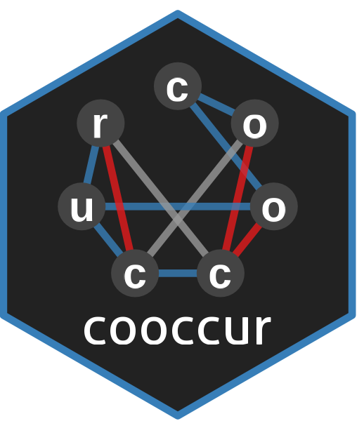

<!-- README.md is generated from README.Rmd. Please edit that file and rebuild
     from the repository root with:
     Rscript -e 'pkgload::load_all(".", quiet = TRUE); knitr::knit("README.Rmd", "README.md")' -->

```{r setup, include = FALSE}
knitr::opts_chunk$set(
  collapse = TRUE, comment = "#>", message = FALSE,
  fig.path = "man/figures/README-", fig.width = 7, fig.height = 5,
  fig.align = "center", out.width = "100%", dpi = 150,
  error = FALSE
)
old_options <- options(width = 90, digits = 3)
has_igraph <- requireNamespace("igraph", quietly = TRUE)
```

# cooccure 

<!-- badges: start -->
[](https://CRAN.R-project.org/package=cooccure)
<!-- badges: end -->

## Vignettes and guides

**Vignettes**

- [Co-occurrence networks](https://pak.dynasite.org/cooccure/articles/cooccure.html)

**Guides**

- [Input formats](https://pak.dynasite.org/cooccure/articles/input-formats.html)
- [Choosing a similarity measure](https://pak.dynasite.org/cooccure/articles/similarity-measures.html)
- [Full, fractional and attention counting](https://pak.dynasite.org/cooccure/articles/counting.html)
- [Sequences, windows and event logs](https://pak.dynasite.org/cooccure/articles/sequences.html)
- [Comparing groups](https://pak.dynasite.org/cooccure/articles/comparing-groups.html)
- [Exporting networks](https://pak.dynasite.org/cooccure/articles/exporting.html)
- [Verification against Nestimate](https://pak.dynasite.org/cooccure/articles/verification.html)

**Case studies**

- [Genre co-occurrence in IMDb films](https://pak.dynasite.org/cooccure/articles/case-imdb-genres.html)
- [Actor collaboration networks](https://pak.dynasite.org/cooccure/articles/case-actor-collaboration.html)

## Overview

`cooccure` builds co-occurrence networks, in which two items are linked when
they appear in the same transaction: the keywords of one article, the genres
of one film, the actors of one cast, the codes of one interview passage, or
the states of one learning session. The network shows which items tend to go
together and how a field, a corpus or a set of sessions is organized around
them. The weight of a link starts as the number of shared transactions.
Because frequent items co-occur often by chance alone, the weight can be
normalized for item frequency by one of eight similarity measures, such as
association strength or the Jaccard index (van Eck & Waltman, 2009), and each
transaction's contribution can be counted fractionally (Perianes-Rodriguez et
al., 2016). One network can be built per group, for example per decade, and
the networks compared.

All of this is done by one function, `cooccurrence()`. It reads delimited
columns, long (item, transaction) tables, binary and one-hot tables, wide
sequences, lists of vectors and event logs; sliding windows turn ordered
sequences into transactions. It returns a tidy edge list with a weight and a
raw count per pair, which converts to the network classes of igraph,
tidygraph, cograph and Nestimate.

## Method

Let $B$ be the transaction-by-item incidence matrix, with $B_{ti} = 1$ when
item $i$ occurs in transaction $t$. The co-occurrence counts are
$C = B^\top B$, with the diagonal set to zero, and $f_i$ is the number of
transactions containing item $i$. Similarity measures rescale $C_{ij}$ by the
frequencies (van Eck & Waltman, 2009):

| `similarity` | Weight of the edge $i$–$j$ |
|---|---|
| `"none"` | $C_{ij}$ |
| `"jaccard"` | $C_{ij} / (f_i + f_j - C_{ij})$ |
| `"cosine"` | $C_{ij} / \sqrt{f_i f_j}$ |
| `"inclusion"` | $C_{ij} / \min(f_i, f_j)$ |
| `"association"` | $C_{ij} / (f_i f_j)$ |
| `"dice"` | $2 C_{ij} / (f_i + f_j)$ |
| `"equivalence"` | $C_{ij}^2 / (f_i f_j)$ |
| `"relative"` | $C_{ij} / \sum_k C_{ik}$ (directed) |

With fractional counting each transaction of $n$ items contributes
$1/(n-1)$ to each of its pairs instead of 1 (Perianes-Rodriguez et al.,
2016); with attention counting a pair contributes
$\exp(-|p_i - p_j| / \lambda)$, decaying with the distance between the two
positions in an ordered transaction. Every measure except `"relative"` gives
an undirected network; `"relative"` divides each row by its sum, so its edges
have a direction and the edge list holds one row per direction.

## Installation

```{r installation, eval = FALSE}
install.packages("cooccure")

# development version
install.packages("remotes")
remotes::install_github("mohsaqr/cooccure")
```

## Examples

`movies` holds 1,000 highly rated films with their genres in one
comma-separated column. Genres are linked when they are assigned to the same
film, and Jaccard similarity discounts the most common genres.

```{r genres}
library(cooccure)

genres <- cooccurrence(movies, field = "genres", sep = ",",
                       similarity = "jaccard", min_occur = 20)
print(genres, n = 6)
```

The weight matrix can be drawn as a heatmap.

```{r heatmap, fig.height = 5.5, fig.cap = "Jaccard weights of the genre network."}
plot(genres)
```

`split_by` builds one network per decade, and the group table compares them.

```{r decades}
by_decade <- cooccurrence(movies, field = "genres", sep = ",",
                          split_by = "decade", similarity = "jaccard",
                          min_occur = 5)
as.data.frame(by_decade, what = "groups")
```

`actors` is a long table with one row per actor and film; actors in the same
film are linked, giving a collaboration network. One decade of a split
network converts to `igraph` with `group =`.

```{r actors, eval = has_igraph}
cast <- cooccurrence(actors, field = "actor", by = "tconst",
                     split_by = "decade", min_occur = 2)
summary(as_igraph(cast, group = "2010s"))
```

## Authors and citation

`cooccure` is written by [Mohammed Saqr](https://saqr.me),
[Sonsoles López-Pernas](https://sonsoles.me) and Kamila Misiejuk. Mohammed
Saqr maintains the package. Questions and bug reports can be submitted
through the [repository issue tracker](https://github.com/mohsaqr/cooccure/issues).
The package citation is available through `citation("cooccure")`.

The bundled `movies`, `actors` and `actor_genres` data are derived from the
IMDb non-commercial datasets (<https://data.imdb.com/non-commercial-datasets/>).

### References

Perianes-Rodriguez, A., Waltman, L., & van Eck, N. J. (2016). Constructing
bibliometric networks: A comparison between full and fractional counting.
*Journal of Informetrics*, *10*(4), 1178--1195.
<https://doi.org/10.1016/j.joi.2016.10.006>

Saqr, M., López-Pernas, S., Conde, M. Á., & Hernández-García, Á. (2024).
Social network analysis: A primer, a guide and a tutorial in R. In M. Saqr &
S. López-Pernas (Eds.), *Learning analytics methods and tutorials: A
practical guide using R*. Springer.
<https://doi.org/10.1007/978-3-031-54464-4_15>

van Eck, N. J., & Waltman, L. (2009). How to normalize cooccurrence data? An
analysis of some well-known similarity measures. *Journal of the American
Society for Information Science and Technology*, *60*(8), 1635--1651.
<https://doi.org/10.1002/asi.21075>

```{r restore-options, include = FALSE}
options(old_options)
```
