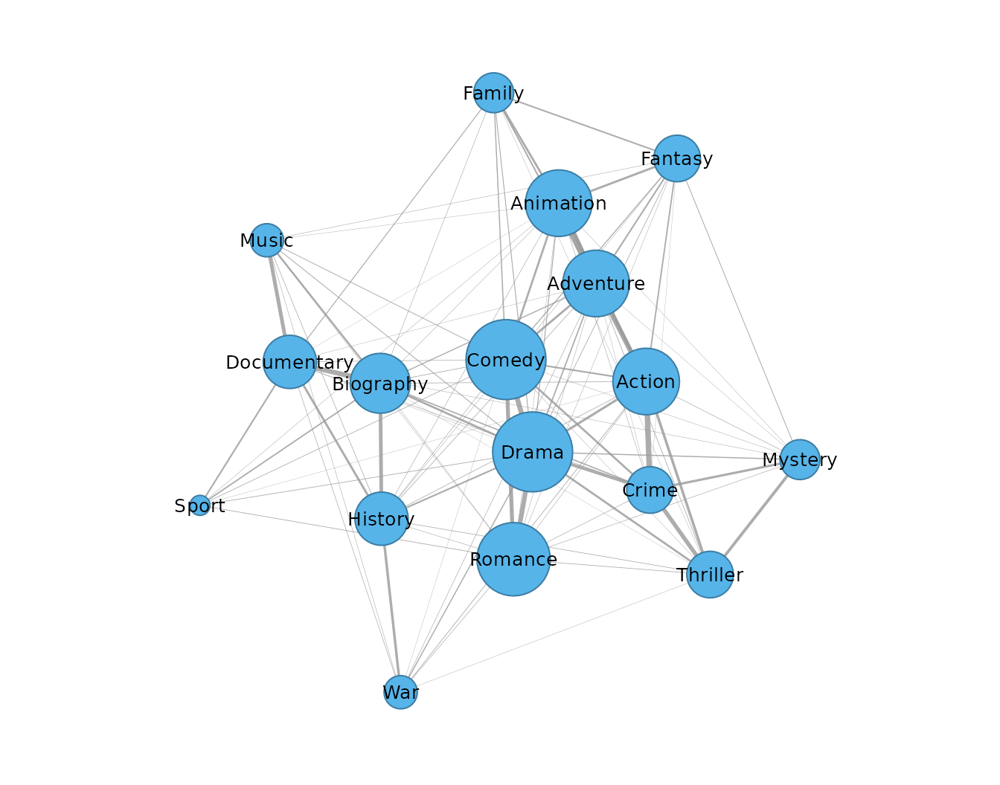
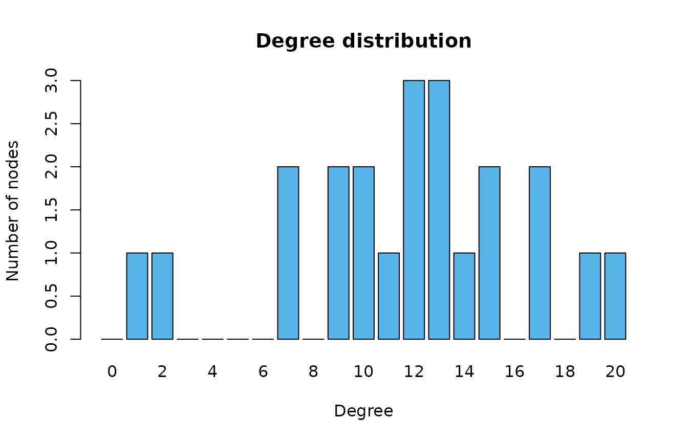

# Case study: genre co-occurrence in IMDb films

Genre labels are a classification that films do not respect. A film is
rarely only a drama or only a comedy; it is a romantic comedy, a crime
drama, an animated adventure. The combinations that recur describe the
conventions of film production better than any single label does, and
the way they change over time traces the history of those conventions. A
co-occurrence network makes the combinations visible: each genre is a
node, and two genres are linked by the films they share.

The difficulty is that raw counts of shared films are dominated by the
most common genres. A genre that appears in most films co-occurs with
everything, so its links say more about its frequency than about any
affinity with a partner. Similarity measures correct for this by
comparing the number of shared films with the number each genre would
share by chance or with the size of the smaller genre (van Eck &
Waltman, 2009). This case study builds the genre network of 1,000 IMDb
films, asks which genres go together once frequency is taken into
account, how the network is organized, and whether the combinations
differ across decades and between the highest-rated films and the rest.

``` r

library(cooccure)
```

## Data

`movies` is a sample of 1,000 films from the IMDb non-commercial
datasets, released between 1970 and 2024, each with an IMDb rating of at
least 7.0 and at least 1,000 votes. The roles of its columns in this
analysis are:

- **Transaction:** a film, identified by `tconst` and named by
  `primaryTitle`.
- **Items:** the genres in `genres`, separated by commas.
- **Grouping variables:** the release `decade`, and the IMDb rating
  `averageRating`, from which a rating band is derived.
- **Not used:** `startYear` and `numVotes`.

``` r

head(movies)
#>       tconst                          primaryTitle startYear                    genres
#> 1  tt0118117                       The War at Home      1996                     Drama
#> 2 tt10534996                                 Josep      2020 Animation,Biography,Drama
#> 3  tt4686844                   The Death of Stalin      2017      Comedy,Drama,History
#> 4  tt0089957 Samaya obayatelnaya i privlekatelnaya      1985            Comedy,Romance
#> 5  tt3469964                         Blind Massage      2014                     Drama
#> 6  tt7647198                       Love and Shukla      2017      Comedy,Drama,Romance
#>   decade averageRating numVotes
#> 1  1990s           7.0     2733
#> 2  2020s           7.4     2340
#> 3  2010s           7.3   126237
#> 4  1980s           7.4     2521
#> 5  2010s           7.2     1804
#> 6  2010s           7.2     1234
```

A film carries up to three genres. A film with a single genre
contributes an item but no pair, so the number of genres per film bounds
what the network can show.

``` r

with(movies, table(genres_per_film = lengths(strsplit(genres, ","))))
#> genres_per_film
#>   1   2   3 
#> 231 300 469
```

Of the 1,000 films, 231 have one genre, 300 have two and 469 have three,
so 769 films contribute at least one pair.

## Which genres appear together most often?

The first network uses raw counts: the weight of an edge is the number
of films tagged with both genres.

``` r

raw_genres <- cooccurrence(movies, field = "genres", sep = ",")
print(raw_genres, n = 8)
#> # cooccurrence: 22 nodes, 129 edges | density: 0.5584 | mean degree: 11.7273 | 1000 transactions
#> # similarity: none | counting: full
#> # possible edges: 231 | isolates: 0
#> # top nodes: Drama(deg=20,str=812), Comedy(deg=19,str=412), Action(deg=17,str=295), Romance(deg=17,str=237), Adventure(deg=15,str=195)
#>       from       to weight count
#>     Comedy    Drama    159   159
#>      Drama  Romance    131   131
#>      Crime    Drama     91    91
#>     Action    Drama     71    71
#>     Comedy  Romance     63    63
#>     Action    Crime     59    59
#>  Biography    Drama     59    59
#>      Drama Thriller     57    57
#> # ... 121 more edges
```

The 22 genres form 129 pairs out of 231 possible, a density of 0.558.
Drama is involved in six of the eight heaviest pairs, beginning with 159
films that are both comedy and drama and 131 that are both drama and
romance. The node table shows why.

``` r

head(as.data.frame(raw_genres, what = "nodes"), 8)
#>          node degree strength count_strength frequency
#> 1       Drama     20      812            812       634
#> 2      Comedy     19      412            412       278
#> 3      Action     17      295            295       155
#> 4     Romance     17      237            237       160
#> 5   Adventure     15      195            195       101
#> 6   Animation     15      149            149        75
#> 7 Documentary     14      138            138       152
#> 8   Biography     13      185            185       108
```

Drama appears in 634 of the 1,000 films (`frequency`) and is linked to
20 of the other 21 genres (`degree`). A genre this common will head any
list of raw counts, whatever its affinity with its partners, so the raw
network answers how often pairs occur rather than which genres belong
together.

## Which genres belong together once frequency is accounted for?

The Jaccard index divides the number of shared films by the number of
films that carry either genre, so a pair scores high only when the two
genres rarely appear apart.

``` r

jaccard_genres <- cooccurrence(movies, field = "genres", sep = ",",
                               similarity = "jaccard")
print(jaccard_genres, n = 8)
#> # cooccurrence: 22 nodes, 129 edges | density: 0.5584 | mean degree: 11.7273 | 1000 transactions
#> # similarity: jaccard | counting: full
#> # possible edges: 231 | isolates: 0
#> # top nodes: Drama(deg=20,str=1.178), Comedy(deg=19,str=0.9227), Action(deg=17,str=1.07), Romance(deg=17,str=0.5551), Adventure(deg=15,str=0.9235)
#>       from          to weight count
#>  Adventure   Animation  0.285    39
#>     Action       Crime  0.237    59
#>     Comedy       Drama  0.211   159
#>     Action   Adventure  0.208    44
#>  Biography Documentary  0.204    44
#>      Drama     Romance  0.198   131
#>      Crime    Thriller  0.175    37
#>     Comedy     Romance  0.168    63
#> # ... 121 more edges
```

The ranking changes. Adventure and Animation lead with a Jaccard index
of 0.285 although they share only 39 films, and Action and Crime come
second. Comedy and Drama, the heaviest raw pair, falls to third (0.211):
the two genres share many films, but each also appears in many films
without the other.

Association strength goes further. It divides the shared films by the
product of the two genres’ frequencies, which is proportional to the
number of shared films expected if genres were assigned independently.
Rare genres can reach high association from a single film, so genres in
fewer than 20 films are removed first.

``` r

association_genres <- cooccurrence(movies, field = "genres", sep = ",",
                                   similarity = "association",
                                   min_occur = 20)
print(association_genres, n = 8)
#> # cooccurrence: 17 nodes, 102 edges | density: 0.7500 | mean degree: 12.0000 | 998 transactions
#> # similarity: association | counting: full
#> # possible edges: 136 | isolates: 0
#> # top nodes: Drama(deg=16,str=0.01308), Comedy(deg=16,str=0.01103), Romance(deg=15,str=0.006945), Animation(deg=14,str=0.01836), Adventure(deg=14,str=0.01681)
#>         from        to  weight count
#>    Adventure Animation 0.00515    39
#>      History       War 0.00454     9
#>      Mystery  Thriller 0.00381    15
#>  Documentary     Music 0.00354    28
#>    Animation   Fantasy 0.00353     9
#>    Biography   History 0.00343    23
#>    Animation    Family 0.00333     9
#>       Family   Fantasy 0.00327     4
#> # ... 94 more edges
```

Five genres fall below 20 films, leaving 17 genres and 998 films; the
two films lost carried only rare genres. Drama has disappeared from the
top of the list. The pairs that co-occur most above chance are Adventure
and Animation, History and War, Mystery and Thriller, Documentary and
Music, and Animation with Fantasy and with Family: combinations that
define a kind of film, such as the animated family adventure, the war
history, or the music documentary. Several of these rest on few films
(History and War on 9), so their weights describe a strong tendency
within a small set.

## How is the genre network organized?

The Jaccard network restricted to genres in at least 20 films is drawn
with **cograph**, with node size proportional to degree and edge width
to the Jaccard index.

``` r

genre_network <- cooccurrence(movies, field = "genres", sep = ",",
                              similarity = "jaccard", min_occur = 20,
                              output = "cograph")
cograph::splot(genre_network, layout = "fr", seed = 1,
               scale_nodes_by = "degree", node_fill = "#56B4E9",
               edge_color = "#999999", label_size = 0.8)
```



In the drawing the heaviest edges are the widest, so the pairs from the
Jaccard table above (Adventure and Animation, Action and Crime, Comedy
and Drama) stand out against a mesh of thin edges: 17 genres share 102
of the 136 possible links.

The degree distribution of the full Jaccard network summarizes how
evenly the links are spread.

``` r

plot(jaccard_genres, type = "degree")
```



The genres with the fewest links are at the end of the node table.

``` r

tail(as.data.frame(jaccard_genres, what = "nodes"), 5)
#>       node degree strength count_strength frequency
#> 18  Horror      9  0.24344             19        11
#> 19   Sport      7  0.19799             44        28
#> 20 Musical      7  0.12197             19        12
#> 21    News      2  0.02271              2         1
#> 22 Western      1  0.00158              1         1
```

Apart from Drama (20 links) and Comedy (19), 16 of the 22 genres are
linked to between 9 and 17 of the other 21. Sport and Musical have 7
links, and only News (2) and Western (1), each tagged on a single film,
are nearly isolated. The network is dense rather than organized around a
few hubs, so what distinguishes one genre from another is the weight of
its links, not their number.

## Have genre combinations changed across decades?

`split_by` builds one network per decade with the same settings. Genres
in fewer than five films of a decade are removed so that each decade’s
network is not driven by single films.

``` r

decade_genres <- cooccurrence(movies, field = "genres", sep = ",",
                              split_by = "decade", similarity = "jaccard",
                              min_occur = 5)
as.data.frame(decade_genres, what = "groups")
#>   group n_nodes n_edges possible_edges density weight_mean count_sum
#> 1 1970s      12      34             66   0.515      0.1334       136
#> 2 1980s      14      43             91   0.473      0.0977       164
#> 3 1990s      13      39             78   0.500      0.1126       187
#> 4 2000s      16      66            120   0.550      0.0769       335
#> 5 2010s      17      85            136   0.625      0.0666       581
#> 6 2020s      13      39             78   0.500      0.1004       184
```

The decades differ in size, from 12 genres in the 1970s to 17 in the
2010s, the decade with the most films in the sample. The density of the
network rises from 0.473 in the 1980s to 0.625 in the 2010s, so more
genre combinations occur, and the mean Jaccard index falls from 0.1334
in the 1970s to 0.0666 in the 2010s, so each combination is less
exclusive. The three strongest pairs of each decade show which
combinations persisted.

``` r

decade_top <- cooccurrence(movies, field = "genres", sep = ",",
                           split_by = "decade", similarity = "jaccard",
                           min_occur = 5, top_n = 3)
print(decade_top, n = 18)
#> # cooccurrence: 12 nodes, 18 edges
#> # split_by: decade (6 groups)
#> # similarity: jaccard | counting: full
#> # isolates: 0 | per-group metrics: summary()
#>         from          to weight count group
#>    Adventure   Animation  0.500     7 1970s
#>        Crime    Thriller  0.429     6 1970s
#>    Biography     History  0.333     4 1970s
#>  Documentary       Music  0.444     4 1980s
#>       Action       Crime  0.233     7 1980s
#>    Biography     History  0.214     3 1980s
#>    Adventure   Animation  0.333     5 1990s
#>      History         War  0.333     3 1990s
#>       Comedy       Drama  0.298    31 1990s
#>       Action   Adventure  0.261    12 2000s
#>       Action       Crime  0.231    12 2000s
#>       Comedy       Drama  0.231    36 2000s
#>       Action       Crime  0.299    26 2010s
#>    Adventure   Animation  0.288    15 2010s
#>    Biography Documentary  0.287    27 2010s
#>       Action   Adventure  0.364     8 2020s
#>    Adventure   Animation  0.250     4 2020s
#>  Documentary       Music  0.243     9 2020s
```

Adventure and Animation is among the three strongest pairs in four of
the six decades (1970s, 1990s, 2010s and 2020s), and Action and Crime in
three (1980s, 2000s and 2010s). Comedy and Drama enters the top three
only in the 1990s and 2000s, and Documentary and Music in the 1980s and
2020s. The animated adventure is the most stable combination in the
sample.

## Do the highest-rated films combine genres differently?

A rating band separates films rated 8 or higher from those rated 7 to
7.9, and one network is built per band.

``` r

rated <- transform(movies, rating_band = ifelse(averageRating >= 8,
                                                "8 and above", "7 to 7.9"))
with(rated, table(rating_band))
#> rating_band
#>    7 to 7.9 8 and above 
#>         861         139
```

The top band holds 139 films and the lower band 861, so genres are
required to appear in at least 10 films of a band.

``` r

cooccurrence(rated, field = "genres", sep = ",", split_by = "rating_band",
             similarity = "jaccard", min_occur = 10, top_n = 4)
#> # cooccurrence: 10 nodes, 8 edges
#> # split_by: rating_band (2 groups)
#> # similarity: jaccard | counting: full
#> # isolates: 0 | per-group metrics: summary()
#>         from          to weight count       group
#>    Adventure   Animation  0.293    36    7 to 7.9
#>       Action       Crime  0.248    55    7 to 7.9
#>       Comedy       Drama  0.213   140    7 to 7.9
#>       Action   Adventure  0.212    40    7 to 7.9
#>  Documentary       Music  0.333    10 8 and above
#>       Comedy       Drama  0.198    19 8 and above
#>    Biography Documentary  0.167     6 8 and above
#>       Comedy     Romance  0.156     7 8 and above
```

The lower band repeats the pattern of the whole sample: Adventure and
Animation, Action and Crime, Comedy and Drama. Among the films rated 8
or higher, Documentary and Music is the strongest pair (0.333, ten
films), followed by Comedy and Drama, Biography and Documentary, and
Comedy and Romance; Action and Adventure pairs do not reach the top
four. The top band is small, and its strongest pairs rest on 6 to 19
films, so the difference indicates where highly rated films concentrate
rather than an established contrast.

## Summary

Raw counts of genre pairs reflect how common each genre is, with Drama
at the top of almost every list. Normalized by the Jaccard index or by
association strength, the network shows the combinations that define
kinds of film: animated adventures, crime thrillers, war histories,
music documentaries. The network is dense rather than clustered, its
combinations became more numerous and less exclusive from the 1970s to
the 2010s, and the highest-rated films lean toward documentary and
biography pairs. For the choice of measure see the [guide to similarity
measures](https://pak.dynasite.org/cooccure/articles/similarity-measures.md),
and for per-group networks the [guide to comparing
groups](https://pak.dynasite.org/cooccure/articles/comparing-groups.md).
The same films are the source of the [actor collaboration case
study](https://pak.dynasite.org/cooccure/articles/case-actor-collaboration.md).

## References

van Eck, N. J., & Waltman, L. (2009). How to normalize cooccurrence
data? An analysis of some well-known similarity measures. *Journal of
the American Society for Information Science and Technology*, 60(8),
1635–1651. <https://doi.org/10.1002/asi.21075>
