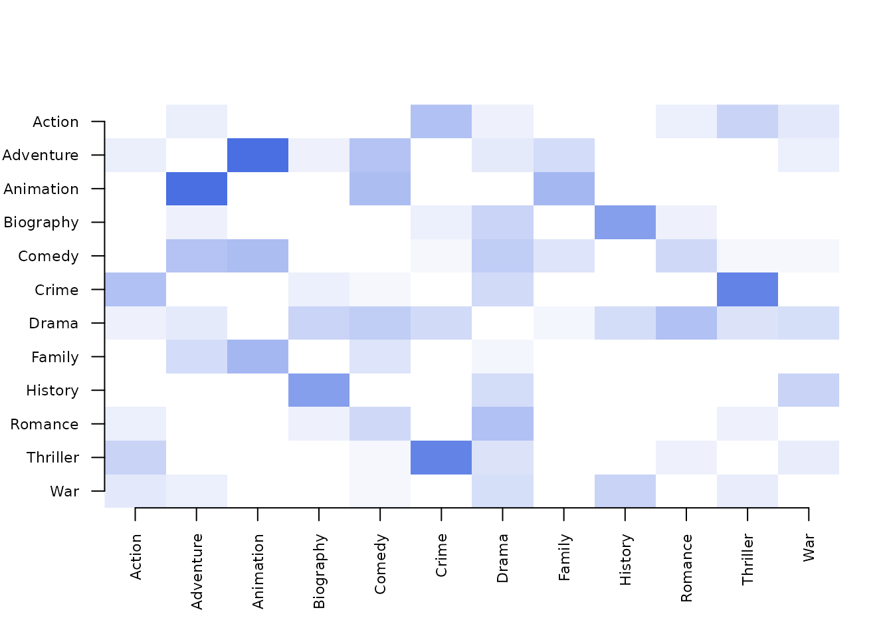

# Comparing groups

Co-occurrence data usually come from a population that is not
homogeneous: articles from several journals, films from several decades,
sessions from several courses. Pooling all transactions into one network
answers how items go together overall, but it hides whether the pattern
holds in every group, and it lets the largest group set the weights. Two
other questions are often the substantive ones. The first is
comparative: does the structure of the network differ between groups,
and does an item hold the same position in each? The second is
integrative: what single network describes the groups when each group is
first analyzed on its own terms, so that differences in group size or
composition do not distort the combined weights?

[`cooccurrence()`](https://pak.dynasite.org/cooccure/reference/cooccurrence.md)
answers the first question with `split_by`, which builds one network per
group and stacks the edge lists with a `group` column, and the second
with `aggregate_by`, which builds one network per group and then
combines the edge weights into one network. This guide applies both to
film genres across decades, shows how to read per-group network and node
metrics, and how to extract, convert or plot a single group’s network.

``` r

library(cooccure)
```

## Data

`movies` holds 1,000 films with an IMDb rating of at least 7.0, released
between 1970 and 2024. In the analyses below:

- **Transaction:** a film (one row).
- **Items:** its genres, in the comma-delimited `genres` column.
- **Grouping variable:** `decade`, the release decade (1970s to 2020s).
- **Second grouping variable:** a rating band derived from
  `averageRating`.

The decades are of unequal size, which matters for any comparison of
network density.

``` r

with(movies, table(decade))
#> decade
#> 1970s 1980s 1990s 2000s 2010s 2020s 
#>    83   105   119   207   327   159
```

The 2010s contribute 327 films and the 1970s 83, so the later networks
rest on about four times as many transactions.

## Does the genre network change across decades?

`split_by = "decade"` builds a separate Jaccard network for each decade.
Genres on fewer than five films within a decade are dropped with
`min_occur = 5`, which is applied within each group.

``` r

by_decade <- cooccurrence(movies, field = "genres", sep = ",",
                          split_by = "decade", similarity = "jaccard",
                          min_occur = 5)
print(by_decade, n = 5)
#> # cooccurrence: 18 nodes, 306 edges
#> # split_by: decade (6 groups)
#> # similarity: jaccard | counting: full
#> # isolates: 0 | per-group metrics: summary()
#>       from        to weight count group
#>  Adventure Animation  0.500     7 1970s
#>      Crime  Thriller  0.429     6 1970s
#>  Biography   History  0.333     4 1970s
#>  Animation    Family  0.250     3 1970s
#>  Animation    Comedy  0.226     7 1970s
#> # ... 301 more edges
```

The result stacks six networks with 306 edges in total over 18 genres.
The header omits a pooled density and mean degree, which are undefined
when the same pair can appear once per group. The per-group metrics come
from [`as.data.frame()`](https://rdrr.io/r/base/as.data.frame.html) with
`what = "groups"`.

``` r

as.data.frame(by_decade, what = "groups")
#>   group n_nodes n_edges possible_edges density weight_mean count_sum
#> 1 1970s      12      34             66   0.515      0.1334       136
#> 2 1980s      14      43             91   0.473      0.0977       164
#> 3 1990s      13      39             78   0.500      0.1126       187
#> 4 2000s      16      66            120   0.550      0.0769       335
#> 5 2010s      17      85            136   0.625      0.0666       581
#> 6 2020s      13      39             78   0.500      0.1004       184
```

The 2010s network is the largest, with 17 genres and 85 edges, and the
densest (0.625); the 1980s network is the sparsest (0.473). The mean
Jaccard weight falls from 0.133 in the 1970s to 0.0666 in the 2010s.
Both trends follow the number of films: with more films, more genre
pairs co-occur at least once, and the added pairs are weak ones.
Differences in density between groups of unequal size are therefore
partly a sample-size effect and should not be read as a change in how
genres combine without a comparison at equal sample size.

## Does a genre hold the same position in every decade?

The node table of a split result has one row per genre per decade, with
the `group` column first.
[`subset()`](https://rdrr.io/r/base/subset.html) selects one genre from
it.

``` r

decade_nodes <- as.data.frame(by_decade, what = "nodes")
subset(decade_nodes, node == "Drama")
#>    group  node degree strength count_strength frequency
#> 1  1970s Drama     10    1.141             73        60
#> 13 1980s Drama     11    1.256             94        68
#> 27 1990s Drama     11    1.058             99        84
#> 40 2000s Drama     15    1.148            168       136
#> 56 2010s Drama     16    1.157            254       200
#> 73 2020s Drama     11    0.949             90        86
```

*Drama* is linked to 10 of the other 11 genres in the 1970s and to 16 of
the other 16 in the 2010s, so it is connected to almost every genre in
every decade. Its strength, the sum of its Jaccard weights, stays
between 0.949 (2020s) and 1.256 (1980s): the number of its ties grows
with the number of genres, but its total association changes little.

## Which genre pairs lead within each decade?

With `split_by`, `top_n` is applied within each group, so `top_n = 3`
keeps the three strongest pairs of every decade.

``` r

decade_top <- cooccurrence(movies, field = "genres", sep = ",",
                           split_by = "decade", similarity = "jaccard",
                           min_occur = 5, top_n = 3)
print(decade_top, n = 18)
#> # cooccurrence: 12 nodes, 18 edges
#> # split_by: decade (6 groups)
#> # similarity: jaccard | counting: full
#> # isolates: 0 | per-group metrics: summary()
#>         from          to weight count group
#>    Adventure   Animation  0.500     7 1970s
#>        Crime    Thriller  0.429     6 1970s
#>    Biography     History  0.333     4 1970s
#>  Documentary       Music  0.444     4 1980s
#>       Action       Crime  0.233     7 1980s
#>    Biography     History  0.214     3 1980s
#>    Adventure   Animation  0.333     5 1990s
#>      History         War  0.333     3 1990s
#>       Comedy       Drama  0.298    31 1990s
#>       Action   Adventure  0.261    12 2000s
#>       Action       Crime  0.231    12 2000s
#>       Comedy       Drama  0.231    36 2000s
#>       Action       Crime  0.299    26 2010s
#>    Adventure   Animation  0.288    15 2010s
#>    Biography Documentary  0.287    27 2010s
#>       Action   Adventure  0.364     8 2020s
#>    Adventure   Animation  0.250     4 2020s
#>  Documentary       Music  0.243     9 2020s
```

*Adventure*–*Animation* is among the three strongest pairs in four of
the six decades, with a Jaccard weight between 0.250 (2020s) and 0.500
(1970s). *Action*–*Crime* is among them in the 1980s, 2000s and 2010s,
and *Comedy*–*Drama* in the 1990s and 2000s. *Documentary*–*Music* leads
in the 1980s (0.444) and returns in the 2020s.

## Do the highest-rated films combine genres differently?

A grouping variable can be derived before the call.
[`transform()`](https://rdrr.io/r/base/transform.html) adds a rating
band, `split_by` builds one network per band, and
[`table()`](https://rdrr.io/r/base/table.html) gives the number of films
in each band.

``` r

rated <- transform(movies,
                   rating_band = ifelse(averageRating >= 8, "8+", "7-7.9"))
cooccurrence(rated, field = "genres", sep = ",", split_by = "rating_band",
             similarity = "jaccard", min_occur = 10, top_n = 3)
#> # cooccurrence: 9 nodes, 6 edges
#> # split_by: rating_band (2 groups)
#> # similarity: jaccard | counting: full
#> # isolates: 0 | per-group metrics: summary()
#>         from          to weight count group
#>    Adventure   Animation  0.293    36 7-7.9
#>       Action       Crime  0.248    55 7-7.9
#>       Comedy       Drama  0.213   140 7-7.9
#>  Documentary       Music  0.333    10    8+
#>       Comedy       Drama  0.198    19    8+
#>    Biography Documentary  0.167     6    8+
with(rated, table(rating_band))
#> rating_band
#> 7-7.9    8+ 
#>   861   139
```

Among films rated 7 to 7.9, the strongest pairs are
*Adventure*–*Animation*, *Action*–*Crime* and *Comedy*–*Drama*, as in
the full data. Among films rated 8 or higher, *Documentary*–*Music*
leads (0.333, on 10 films) and *Biography*–*Documentary* enters the top
three. The 8+ band has 139 films against 861, so its network rests on
few transactions.

## How is one group’s network extracted?

A split result holds several networks and has no single weight matrix or
graph. A converter called on it without a group stops with a condition
of class `cooccure_grouped_input` that lists the groups.

``` r

as_matrix(by_decade)
#> Error:
#> ! This result stacks 6 networks built with `split_by`, so it cannot be converted as one network. Pass `group =` naming one of: 1970s, 1980s, 1990s, 2000s, 2010s, 2020s.
```

Passing `group =` converts that group’s network, with its own items,
isolates included.

``` r

decade_2010s <- as_igraph(by_decade, group = "2010s")
decade_2010s
#> IGRAPH ca279ba UNW- 17 85 -- 
#> + attr: name (v/c), weight (e/n), count (e/n)
#> + edges from ca279ba (vertex names):
#>  [1] Action     --Crime       Adventure  --Animation   Biography  --Documentary
#>  [4] Action     --Adventure   Comedy     --Drama       Biography  --History    
#>  [7] Crime      --Thriller    Animation  --Fantasy     Action     --Thriller   
#> [10] Comedy     --Romance     Drama      --Romance     Mystery    --Thriller   
#> [13] Crime      --Drama       Action     --Animation   Documentary--History    
#> [16] Crime      --Mystery     Biography  --Drama       Action     --Drama      
#> [19] Documentary--Music       Adventure  --Comedy      Family     --Fantasy    
#> [22] Action     --Comedy      Drama      --Thriller    Animation  --Family     
#> + ... omitted several edges
```

The 2010s graph has 17 vertices and 85 edges, the values in the group
table.
[`as_matrix()`](https://pak.dynasite.org/cooccure/reference/as_matrix.md),
[`as_tidygraph()`](https://pak.dynasite.org/cooccure/reference/as_tidygraph.md),
[`as_cograph()`](https://pak.dynasite.org/cooccure/reference/as_cograph.md),
[`as_netobject()`](https://pak.dynasite.org/cooccure/reference/as_netobject.md)
and [`plot()`](https://rdrr.io/r/graphics/plot.default.html) take the
same argument.

``` r

plot(by_decade, group = "1970s")
```



The heatmap of the 1970s network shows the weight of each pair, from
white (no co-occurrence) to blue (the strongest pair,
*Adventure*–*Animation* at 0.5). Rows and columns follow the
alphabetical order of the 12 genres of that decade.

## How are groups combined into one network?

`aggregate_by` also builds one network per decade, with the chosen
similarity and `min_occur` applied within each decade, and then combines
the weights of each pair across decades. The edge list has one row per
pair; `count` is always summed. For comparison, the pooled network
ignores the decades.

``` r

cooccurrence(movies, field = "genres", sep = ",", similarity = "jaccard",
             top_n = 4)
#> # cooccurrence: 22 nodes, 4 edges | density: 0.0173 | mean degree: 0.3636 | 1000 transactions
#> # similarity: jaccard | counting: full
#> # possible edges: 231 | isolates: 16
#> # top nodes: Adventure(deg=2,str=0.4922), Action(deg=2,str=0.4445), Animation(deg=1,str=0.2847), Crime(deg=1,str=0.2369), Comedy(deg=1,str=0.2112)
#>       from        to weight count
#>  Adventure Animation  0.285    39
#>     Action     Crime  0.237    59
#>     Comedy     Drama  0.211   159
#>     Action Adventure  0.208    44
```

Pooled over all films, *Adventure*–*Animation* has a Jaccard weight of
0.285. With `aggregate = "mean"`, each decade’s Jaccard weight counts
equally, whatever the number of films in that decade.

``` r

cooccurrence(movies, field = "genres", sep = ",", similarity = "jaccard",
             aggregate_by = "decade", aggregate = "mean", min_occur = 5,
             top_n = 4)
#> # cooccurrence: 18 nodes, 4 edges | density: 0.0261 | mean degree: 0.4444 | 997 transactions
#> # aggregate_by: decade (6 groups, mean)
#> # similarity: jaccard | counting: full
#> # possible edges: 153 | isolates: 10
#> # top nodes: Adventure(deg=1,str=0.2921), Animation(deg=1,str=0.2921), Documentary(deg=1,str=0.2421), Music(deg=1,str=0.2421), Action(deg=1,str=0.2232)
#>         from        to weight count
#>    Adventure Animation  0.292    39
#>  Documentary     Music  0.242    28
#>       Action     Crime  0.223    59
#>       Comedy     Drama  0.211   159
```

*Adventure*–*Animation* keeps the lead at 0.292, and
*Documentary*–*Music* rises to second (0.242). The mean is taken over
the decades in which a pair occurs, not over all six. The per-decade
weights of this pair show it.

``` r

subset(as.data.frame(by_decade),
       from == "Documentary" & to %in% c("Music", "War"))
#>            from    to weight count group
#> 35  Documentary Music 0.4444     4 1980s
#> 86  Documentary   War 0.1818     2 1990s
#> 123 Documentary Music 0.1860     8 2000s
#> 201 Documentary Music 0.0946     7 2010s
#> 270 Documentary Music 0.2432     9 2020s
```

*Documentary*–*Music* occurs in four decades, with weights 0.444, 0.186,
0.0946 and 0.243, whose mean is 0.242; its `count` of 28 in the combined
network is 4 + 8 + 7 + 9. *Documentary*–*War* occurs in the 1990s only.
The other combiners answer different questions.

``` r

cooccurrence(movies, field = "genres", sep = ",", similarity = "jaccard",
             aggregate_by = "decade", aggregate = "sum", min_occur = 5,
             top_n = 4)
#> # cooccurrence: 18 nodes, 4 edges | density: 0.0261 | mean degree: 0.4444 | 997 transactions
#> # aggregate_by: decade (6 groups, sum)
#> # similarity: jaccard | counting: full
#> # possible edges: 153 | isolates: 11
#> # top nodes: Drama(deg=2,str=2.495), Adventure(deg=1,str=1.753), Animation(deg=1,str=1.753), Action(deg=1,str=1.339), Crime(deg=1,str=1.339)
#>       from        to weight count
#>  Adventure Animation   1.75    39
#>     Action     Crime   1.34    59
#>     Comedy     Drama   1.27   159
#>      Drama   Romance   1.23   131
```

With `"sum"`, a pair gains weight from every decade in which it occurs,
so pairs present throughout lead: *Adventure*–*Animation* reaches 1.75
summed over six decades. The sum rewards persistence as well as
strength.

``` r

cooccurrence(movies, field = "genres", sep = ",", similarity = "jaccard",
             aggregate_by = "decade", aggregate = "max", min_occur = 5,
             top_n = 4)
#> # cooccurrence: 18 nodes, 4 edges | density: 0.0261 | mean degree: 0.4444 | 997 transactions
#> # aggregate_by: decade (6 groups, max)
#> # similarity: jaccard | counting: full
#> # possible edges: 153 | isolates: 11
#> # top nodes: Adventure(deg=2,str=0.8636), Animation(deg=1,str=0.5), Documentary(deg=1,str=0.4444), Music(deg=1,str=0.4444), Crime(deg=1,str=0.4286)
#>         from        to weight count
#>    Adventure Animation  0.500    39
#>  Documentary     Music  0.444    28
#>        Crime  Thriller  0.429    37
#>       Action Adventure  0.364    44
cooccurrence(movies, field = "genres", sep = ",", similarity = "jaccard",
             aggregate_by = "decade", aggregate = "min", min_occur = 5,
             top_n = 4)
#> # cooccurrence: 18 nodes, 4 edges | density: 0.0261 | mean degree: 0.4444 | 997 transactions
#> # aggregate_by: decade (6 groups, min)
#> # similarity: jaccard | counting: full
#> # possible edges: 153 | isolates: 11
#> # top nodes: Drama(deg=2,str=0.3297), Documentary(deg=1,str=0.1818), War(deg=1,str=0.1818), Comedy(deg=1,str=0.1711), Adventure(deg=1,str=0.1667)
#>         from        to weight count
#>  Documentary       War  0.182     2
#>       Comedy     Drama  0.171   159
#>    Adventure Animation  0.167    39
#>        Drama   Romance  0.159   131
```

`"max"` keeps each pair’s strongest decade, so *Adventure*–*Animation*
and *Crime*–*Thriller* carry their 1970s weights (0.500 and 0.429).
`"min"` keeps each pair’s weakest decade among those in which it occurs.
Its top pair, *Documentary*–*War* (0.182, count 2), occurs in the 1990s
only, as shown above, so its minimum is its single weight. `"min"` is
therefore a measure of consistency only for pairs present in every
group; combine it with a check of how many groups contain the pair.

## Which to use?

- `split_by` when the groups are to be compared: per-group networks, the
  group table and the per-group node table.
- `aggregate_by` with `"mean"` when one network should give every group
  the same weight; with `"sum"` when a pair’s recurrence across groups
  should add to its weight; with `"max"` for the strongest group.
- Neither, when the groups are a nuisance and the pooled network is the
  object of interest.

Threshold and `top_n` are applied within each group for `split_by` and
after combining for `aggregate_by`. Exporting a single group is shown in
[Exporting
networks](https://pak.dynasite.org/cooccure/articles/exporting.md);
similarity choices in [Choosing a similarity
measure](https://pak.dynasite.org/cooccure/articles/similarity-measures.md).
