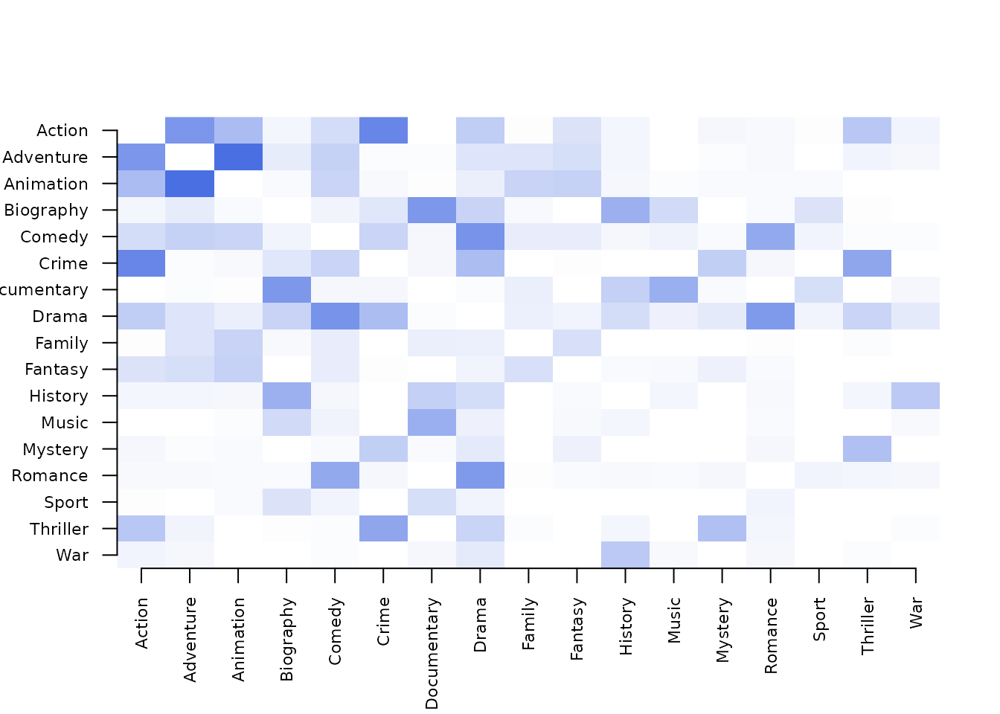
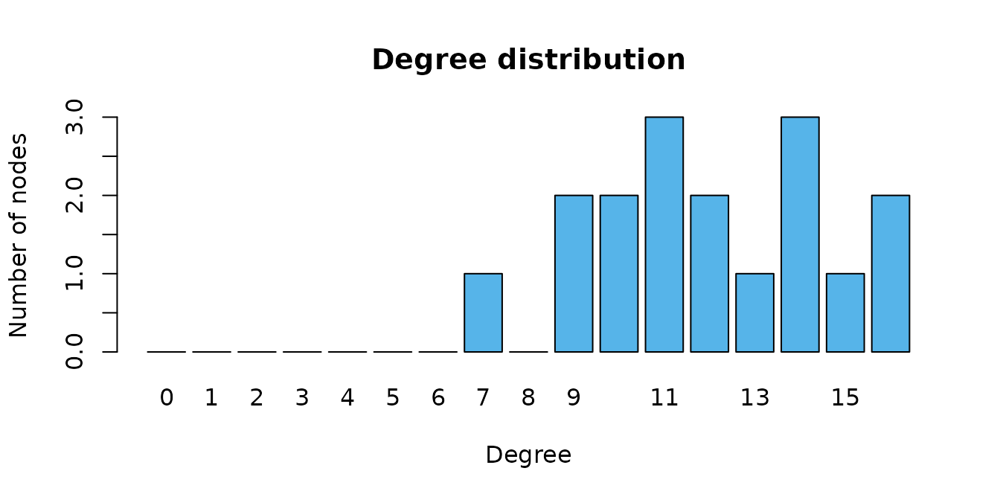

# Co-occurrence networks

Many data sets record which things appear together: the keywords of an
article, the genres of a film, the members of a team, the codes applied
to an interview passage, or the activities of a learning session. A
co-occurrence network turns such records into relations. Each distinct
item becomes a node, and two items are linked when they appear in the
same record, called a transaction. The weight of a link is, at its
simplest, the number of transactions the two items share. The network
then shows which items form clusters, which act as bridges between
clusters, and which are peripheral.

Raw counts mix two things: how strongly two items are associated and how
common each of them is. A frequent item co-occurs with almost every
other item because it appears so often. Similarity measures separate the
two by comparing the observed co-occurrence with the items’ own
frequencies (van Eck & Waltman, 2009), and fractional counting reduces
the weight of transactions that contain many items (Perianes-Rodriguez
et al., 2016). Co-occurrence analysis is used in bibliometrics, text
analysis and learning analytics, where it is one of the standard ways of
building networks from records (Saqr et al., 2024).

This vignette builds a genre network from a sample of films with one
call to
[`cooccurrence()`](https://pak.dynasite.org/cooccure/reference/cooccurrence.md),
normalizes it, summarizes it, draws it, splits it by decade, and
converts it for other network packages.

``` r

library(cooccure)
```

## Data

`movies` holds 1,000 films with an IMDb rating of at least 7.0 and at
least 1,000 votes, released between 1970 and 2024:

- **Transaction:** `tconst`, the film; one row per film.
- **Items:** `genres`, the film’s genres in one comma-separated column,
  such as `"Comedy,Drama,History"`.
- **Groups:** `decade`, the release decade; `averageRating`, the IMDb
  rating.
- **Other:** `primaryTitle`, `startYear`, `numVotes`.

``` r

head(movies)
#>       tconst                          primaryTitle startYear                    genres
#> 1  tt0118117                       The War at Home      1996                     Drama
#> 2 tt10534996                                 Josep      2020 Animation,Biography,Drama
#> 3  tt4686844                   The Death of Stalin      2017      Comedy,Drama,History
#> 4  tt0089957 Samaya obayatelnaya i privlekatelnaya      1985            Comedy,Romance
#> 5  tt3469964                         Blind Massage      2014                     Drama
#> 6  tt7647198                       Love and Shukla      2017      Comedy,Drama,Romance
#>   decade averageRating numVotes
#> 1  1990s           7.0     2733
#> 2  2020s           7.4     2340
#> 3  2010s           7.3   126237
#> 4  1980s           7.4     2521
#> 5  2010s           7.2     1804
#> 6  2010s           7.2     1234
```

## Which genres appear together?

The genres of a film are separated by commas, so `field` names the
column and `sep` the separator. Each film is a transaction, and each
pair of its genres gains one unit of weight.

``` r

net <- cooccurrence(movies, field = "genres", sep = ",")
print(net, n = 5)
#> # cooccurrence: 22 nodes, 129 edges | density: 0.5584 | mean degree: 11.7273 | 1000 transactions
#> # similarity: none | counting: full
#> # possible edges: 231 | isolates: 0
#> # top nodes: Drama(deg=20,str=812), Comedy(deg=19,str=412), Action(deg=17,str=295), Romance(deg=17,str=237), Adventure(deg=15,str=195)
#>    from      to weight count
#>  Comedy   Drama    159   159
#>   Drama Romance    131   131
#>   Crime   Drama     91    91
#>  Action   Drama     71    71
#>  Comedy Romance     63    63
#> # ... 124 more edges
```

The header describes the network before any edge is read: 22 genres, 129
of the 231 possible pairs linked (a density of 0.56), and 1,000 films.
Drama is linked to 20 of the other 21 genres. The strongest edges are
all pairs with Drama or Comedy, the two most common genres: Comedy and
Drama share 159 films, Drama and Romance 131. These counts describe
volume more than affinity.

## Which genres belong together?

The Jaccard similarity divides the number of shared films by the number
of films that carry either genre, so a pair scores high only when the
two genres rarely appear apart. Genres tagged on fewer than 20 films are
dropped with `min_occur`, since a similarity built on one or two films
is unstable.

``` r

jac <- cooccurrence(movies, field = "genres", sep = ",",
                    similarity = "jaccard", min_occur = 20)
print(jac, n = 8)
#> # cooccurrence: 17 nodes, 102 edges | density: 0.7500 | mean degree: 12.0000 | 998 transactions
#> # similarity: jaccard | counting: full
#> # possible edges: 136 | isolates: 0
#> # top nodes: Drama(deg=16,str=1.153), Comedy(deg=16,str=0.8949), Romance(deg=15,str=0.5377), Action(deg=14,str=1.009), Adventure(deg=14,str=0.8788)
#>       from          to weight count
#>  Adventure   Animation  0.285    39
#>     Action       Crime  0.237    59
#>     Comedy       Drama  0.211   159
#>     Action   Adventure  0.208    44
#>  Biography Documentary  0.204    44
#>      Drama     Romance  0.198   131
#>      Crime    Thriller  0.175    37
#>     Comedy     Romance  0.168    63
#> # ... 94 more edges
```

Five rare genres and the two films tagged only with them drop out,
leaving 17 genres and 998 films. Under Jaccard, Adventure and Animation
become the closest pair (0.285, 39 shared films), followed by Action and
Crime (0.237). Comedy and Drama, the largest pair by count, fall to
third place (0.211): they share many films, but each also appears in
many films without the other. The [similarity
guide](https://pak.dynasite.org/cooccure/articles/similarity-measures.html)
compares all eight measures.

## How is the network structured?

[`summary()`](https://rdrr.io/r/base/summary.html) computes
network-level metrics and the parameters used.

``` r

summary(jac)
#> cooccurrence network
#> ------------------------------
#> Nodes          : 17
#> Edges          : 102
#> Possible edges : 136
#> Density        : 0.7500
#> Mean degree    : 12.0000
#> Isolates       : 0
#> Transactions   : 998
#> Similarity     : jaccard
#> Counting       : full
#> Weight range   : [0.004425, 0.2847]
#> Weight mean    : 0.05131
#> Count range    : [1, 159]
#> Count mean     : 16.05
#> Top nodes      : Drama(16, 1.153), Comedy(16, 0.8949), Romance(15, 0.5377), Action(14, 1.009), Adventure(14, 0.8788)
```

Three of every four possible pairs are linked (density 0.75), with a
mean degree of 12 out of a possible 16. The weights are small, between
0.004 and 0.285 with a mean of 0.051, so most links are weak and a few
carry the structure. The node table gives the same metrics per genre.

``` r

head(as.data.frame(jac, what = "nodes"))
#>        node degree strength count_strength frequency
#> 1     Drama     16    1.153            796       634
#> 2    Comedy     16    0.895            404       278
#> 3   Romance     15    0.538            234       160
#> 4    Action     14    1.009            285       155
#> 5 Adventure     14    0.879            190       101
#> 6 Animation     14    0.791            147        75
```

Drama and Comedy are linked to every other genre (degree 16), but Action
has nearly the same total Jaccard strength as Drama (1.009 against
1.153) with two fewer links, because its links are stronger. The
`frequency` column is the number of films carrying each genre: 634 for
Drama against 155 for Action.

## What does the network look like?

The heatmap shows the weight matrix: rows and columns are genres, darker
cells are stronger links, and white cells are pairs that never co-occur.

``` r

plot(jac)
```



The strongest cells fall in small groups of genres rather than in one
dominant row: Adventure, Animation and Action are linked pairwise with
weights between 0.133 and 0.285, and Biography, Documentary and History
with weights between 0.092 and 0.204. The degree distribution summarizes
how evenly the links are spread.

``` r

plot(jac, type = "degree")
```



Every genre has between 7 and 16 links, and 9 of the 17 have 12 or more,
so the network is dense and not organized around a single hub; its
structure lies in the weights.

## Does the network change over time?

`split_by` builds one network per value of a column, here one per
release decade, and stacks the edge lists with a `group` column. The
group table compares the networks.

``` r

by_decade <- cooccurrence(movies, field = "genres", sep = ",",
                          split_by = "decade", similarity = "jaccard",
                          min_occur = 5)
as.data.frame(by_decade, what = "groups")
#>   group n_nodes n_edges possible_edges density weight_mean count_sum
#> 1 1970s      12      34             66   0.515      0.1334       136
#> 2 1980s      14      43             91   0.473      0.0977       164
#> 3 1990s      13      39             78   0.500      0.1126       187
#> 4 2000s      16      66            120   0.550      0.0769       335
#> 5 2010s      17      85            136   0.625      0.0666       581
#> 6 2020s      13      39             78   0.500      0.1004       184
```

The 2010s network is the largest (17 genres, 85 edges) and the densest
(0.625), and the 1980s network the sparsest (0.473). The mean Jaccard
weight is highest in the 1970s (0.133), when fewer genres were in use
and the ones that were combined did so more consistently. The [guide on
comparing
groups](https://pak.dynasite.org/cooccure/articles/comparing-groups.html)
covers per-group conversion and `aggregate_by`, which pools groups into
one network.

## How is the network used elsewhere?

The edge list converts to the classes of other network packages. Here
the Jaccard network becomes an `igraph` graph and the weighted degree
(strength) of each genre is computed there.

``` r

g <- as_igraph(jac)
g
#> IGRAPH c594546 UNW- 17 102 -- 
#> + attr: name (v/c), weight (e/n), count (e/n)
#> + edges from c594546 (vertex names):
#>  [1] Adventure  --Animation   Action     --Crime       Comedy     --Drama      
#>  [4] Action     --Adventure   Biography  --Documentary Drama      --Romance    
#>  [7] Crime      --Thriller    Comedy     --Romance     Documentary--Music      
#> [10] Biography  --History     Action     --Animation   Crime      --Drama      
#> [13] Mystery    --Thriller    Action     --Thriller    History    --War        
#> [16] Action     --Drama       Crime      --Mystery     Documentary--History    
#> [19] Animation  --Fantasy     Adventure  --Comedy      Animation  --Family     
#> [22] Biography  --Drama       Drama      --Thriller    Comedy     --Crime      
#> + ... omitted several edges
```

The graph has the 17 genres as vertices and the 102 edges with their
`weight` and `count` attributes, so any igraph function can be applied.
The [export
guide](https://pak.dynasite.org/cooccure/articles/exporting.html) covers
igraph, tidygraph, cograph, Nestimate, matrices and Gephi files.

## Further reading

The guides cover [input
formats](https://pak.dynasite.org/cooccure/articles/input-formats.html),
[counting](https://pak.dynasite.org/cooccure/articles/counting.html),
[sequences, windows and event
logs](https://pak.dynasite.org/cooccure/articles/sequences.html) and the
[verification against
Nestimate](https://pak.dynasite.org/cooccure/articles/verification.html).
Two case studies analyze [genre
co-occurrence](https://pak.dynasite.org/cooccure/articles/case-imdb-genres.html)
and [actor
collaboration](https://pak.dynasite.org/cooccure/articles/case-actor-collaboration.html)
in the IMDb sample.

## References

Perianes-Rodriguez, A., Waltman, L., & van Eck, N. J. (2016).
Constructing bibliometric networks: A comparison between full and
fractional counting. *Journal of Informetrics*, *10*(4), 1178–1195.
<https://doi.org/10.1016/j.joi.2016.10.006>

Saqr, M., López-Pernas, S., Conde, M. Á., & Hernández-García, Á. (2024).
Social network analysis: A primer, a guide and a tutorial in R. In M.
Saqr & S. López-Pernas (Eds.), *Learning analytics methods and
tutorials: A practical guide using R*. Springer.
<https://doi.org/10.1007/978-3-031-54464-4_15>

van Eck, N. J., & Waltman, L. (2009). How to normalize cooccurrence
data? An analysis of some well-known similarity measures. *Journal of
the American Society for Information Science and Technology*, *60*(8),
1635–1651. <https://doi.org/10.1002/asi.21075>
