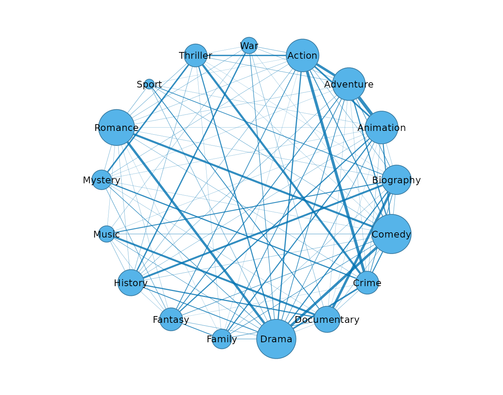
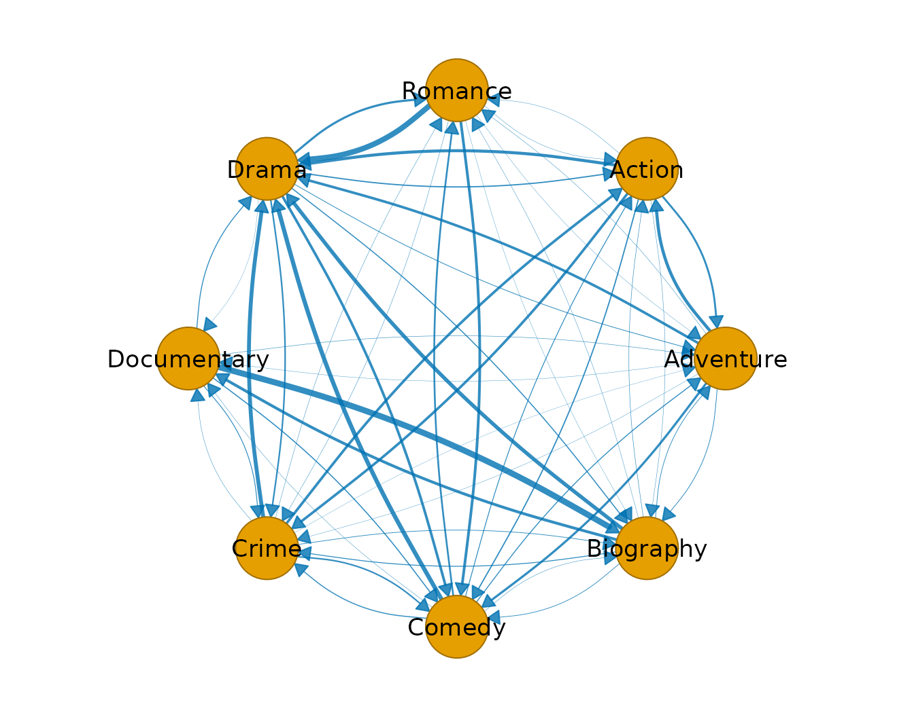

# Exporting networks

Building a co-occurrence network is rarely the last step of an analysis.
The network is then described with centrality measures, partitioned into
communities, drawn for publication, compared with networks estimated by
other methods, or handed to software outside R. Each of these tasks has
its own established tools and data structures: an edge table for
spreadsheet software and Gephi, a weight matrix for clustering and
matrix algebra, and graph objects for the R network libraries. A network
that can be moved between them without re-entering its edges keeps the
analysis reproducible and lets each tool be used for what it does best.

[`cooccurrence()`](https://pak.dynasite.org/cooccure/reference/cooccurrence.md)
returns the network as a tidy edge list. This guide shows how to turn it
into each of the other forms: a Gephi-ready table, a weight matrix, and
graph objects for , , and . It ends with the directed `relative`
network, which every format keeps directed, and with networks built per
group.

``` r

library(cooccure)
```

## Data

`movies` holds 1,000 films with an IMDb rating of at least 7.0, released
between 1970 and 2024. In the analyses below:

- **Transaction:** a film (one row).
- **Items:** its genres, in the comma-delimited `genres` column.
- **Grouping variable:** `decade`, used in the last section.

The network used throughout links genres on at least 20 films by their
Jaccard similarity.

``` r

genre_net <- cooccurrence(movies, field = "genres", sep = ",",
                          similarity = "jaccard", min_occur = 20)
print(genre_net, n = 3)
#> # cooccurrence: 17 nodes, 102 edges | density: 0.7500 | mean degree: 12.0000 | 998 transactions
#> # similarity: jaccard | counting: full
#> # possible edges: 136 | isolates: 0
#> # top nodes: Drama(deg=16,str=1.153), Comedy(deg=16,str=0.8949), Romance(deg=15,str=0.5377), Action(deg=14,str=1.009), Adventure(deg=14,str=0.8788)
#>       from        to weight count
#>  Adventure Animation  0.285    39
#>     Action     Crime  0.237    59
#>     Comedy     Drama  0.211   159
#> # ... 99 more edges
```

The network has 17 genres and 102 edges, a density of 0.75: three
quarters of all genre pairs co-occur on at least one film.

## How is the network written to a file?

The edge table itself is a data frame.
[`as.data.frame()`](https://rdrr.io/r/base/as.data.frame.html) drops the
network attributes and returns the columns `from`, `to`, `weight` and
`count`, ready for
[`write.csv()`](https://rdrr.io/r/utils/write.table.html) or any other
writer.

``` r

genre_edges <- as.data.frame(genre_net)
head(genre_edges, 3)
#>        from        to weight count
#> 1 Adventure Animation  0.285    39
#> 2    Action     Crime  0.237    59
#> 3    Comedy     Drama  0.211   159
```

The node table, with degree, strength and frequency for every genre, is
returned by the same accessor with `what = "nodes"`.

``` r

head(as.data.frame(genre_net, what = "nodes"), 3)
#>      node degree strength count_strength frequency
#> 1   Drama     16    1.153            796       634
#> 2  Comedy     16    0.895            404       278
#> 3 Romance     15    0.538            234       160
```

*Drama* and *Comedy* are linked to all 16 other genres, and *Drama*
appears on 634 films.

## How is the network opened in Gephi?

Gephi imports an edge table with the columns `Source`, `Target`,
`Weight` and `Type`. `output = "gephi"` returns the edges under those
names, with `Type` set to `"Undirected"` and the raw count in `Count`.

``` r

genre_gephi <- cooccurrence(movies, field = "genres", sep = ",",
                            similarity = "jaccard", min_occur = 20,
                            output = "gephi")
head(as.data.frame(genre_gephi), 3)
#>      Source    Target Weight       Type Count
#> 1 Adventure Animation  0.285 Undirected    39
#> 2    Action     Crime  0.237 Undirected    59
#> 3    Comedy     Drama  0.211 Undirected   159
```

The table is written to CSV and opened in Gephi’s data laboratory as an
edge table.

``` r

gephi_file <- file.path(tempdir(), "genre_network.csv")
write.csv(as.data.frame(genre_gephi), gephi_file, row.names = FALSE)
file.exists(gephi_file)
#> [1] TRUE
```

## How is the weight matrix obtained?

Many methods (hierarchical clustering, multidimensional scaling,
heatmaps) expect a square matrix rather than an edge list.
[`as_matrix()`](https://pak.dynasite.org/cooccure/reference/as_matrix.md)
returns the weight matrix, and `type = "raw"` the matrix of counts.

``` r

genre_matrix <- as_matrix(genre_net)
dim(genre_matrix)
#> [1] 17 17
isSymmetric(genre_matrix)
#> [1] TRUE
```

The matrix has one row and one column for each of the 17 genres and is
symmetric, because Jaccard similarity is. It agrees with the edge list,
including any `threshold` or `top_n` filter; `output = "matrix"` returns
the same matrix from the call that builds the network.

## How is the network analyzed with igraph?

[`as_igraph()`](https://pak.dynasite.org/cooccure/reference/as_igraph.md)
creates a weighted graph with one vertex per genre and the edge
attributes `weight` and `count`.

``` r

genre_graph <- as_igraph(genre_net)
genre_graph
#> IGRAPH a628862 UNW- 17 102 -- 
#> + attr: name (v/c), weight (e/n), count (e/n)
#> + edges from a628862 (vertex names):
#>  [1] Adventure  --Animation   Action     --Crime       Comedy     --Drama      
#>  [4] Action     --Adventure   Biography  --Documentary Drama      --Romance    
#>  [7] Crime      --Thriller    Comedy     --Romance     Documentary--Music      
#> [10] Biography  --History     Action     --Animation   Crime      --Drama      
#> [13] Mystery    --Thriller    Action     --Thriller    History    --War        
#> [16] Action     --Drama       Crime      --Mystery     Documentary--History    
#> [19] Animation  --Fantasy     Adventure  --Comedy      Animation  --Family     
#> [22] Biography  --Drama       Drama      --Thriller    Comedy     --Crime      
#> + ... omitted several edges
```

The graph is undirected (`U` in `UNW-`), named and weighted, with 17
vertices and 102 edges. Any function applies to it; strength sums the
Jaccard weights of each genre’s edges.

``` r

sort(igraph::strength(genre_graph), decreasing = TRUE)
#>       Drama      Action      Comedy   Adventure       Crime   Animation   Biography 
#>       1.153       1.009       0.895       0.879       0.829       0.791       0.745 
#> Documentary    Thriller     History     Romance     Fantasy     Mystery       Music 
#>       0.633       0.581       0.549       0.538       0.393       0.355       0.344 
#>      Family         War       Sport 
#>       0.335       0.244       0.198
```

*Drama* (1.15) and *Action* (1.01) have the largest total similarity to
the other genres, and *Sport* (0.198) the smallest. reads the `weight`
attribute as a distance in path-based measures such as betweenness and
closeness, so for those a similarity weight should first be inverted.

## How is the network used with tidygraph?

[`as_tidygraph()`](https://pak.dynasite.org/cooccure/reference/as_tidygraph.md)
returns the same graph as a `tbl_graph`, whose node and edge tables can
be modified with verbs and drawn with .

``` r

as_tidygraph(genre_net)
#> # A tbl_graph: 17 nodes and 102 edges
#> #
#> # An undirected simple graph with 1 component
#> #
#> # Node Data: 17 × 1 (active)
#>    name       
#>    <chr>      
#>  1 Action     
#>  2 Adventure  
#>  3 Animation  
#>  4 Biography  
#>  5 Comedy     
#>  6 Crime      
#>  7 Documentary
#>  8 Drama      
#>  9 Family     
#> 10 Fantasy    
#> 11 History    
#> 12 Music      
#> 13 Mystery    
#> 14 Romance    
#> 15 Sport      
#> 16 Thriller   
#> 17 War        
#> #
#> # Edge Data: 102 × 4
#>    from    to weight count
#>   <int> <int>  <dbl> <dbl>
#> 1     2     3  0.285    39
#> 2     1     6  0.237    59
#> 3     5     8  0.211   159
#> # ℹ 99 more rows
```

The node table holds the 17 genre names and the edge table the 102 edges
with their weights and counts, the endpoints given as row numbers of the
node table.

## How is the network drawn with cograph?

draws networks from a weight matrix. `output = "cograph"` builds the
network directly as a `cograph_network`, which
[`cograph::splot()`](https://sonsoles.me/cograph/reference/splot.html)
draws.

``` r

genre_cograph <- cooccurrence(movies, field = "genres", sep = ",",
                              similarity = "jaccard", min_occur = 20,
                              output = "cograph")
cograph::splot(genre_cograph, layout = "circle", node_fill = "#56B4E9",
               edge_color = "#0072B2", scale_nodes_by = "degree",
               label_size = 0.8)
```



Node size follows degree and edge width follows the Jaccard weight, so
the thick edges mark the strongest genre pairs, such as
*Adventure*–*Animation*.

exports its own
[`as_cograph()`](https://pak.dynasite.org/cooccure/reference/as_cograph.md).
When is attached after , a bare `as_cograph(genre_net)` calls the
version, which reads the edge data frame with its own defaults. Use
`output = "cograph"` as above or call the function with its namespace,
`cooccure::as_cograph(genre_net)`.

## How is the network passed to Nestimate?

stores estimated networks as `netobject`s.
[`as_netobject()`](https://pak.dynasite.org/cooccure/reference/as_netobject.md)
converts the co-occurrence network, recording the similarity, scale,
threshold and number of transactions as parameters, so that it can be
used with ’s network functions.

``` r

genre_netobject <- as_netobject(genre_net)
head(Nestimate::net_centrality(genre_netobject))
#> centralities computed excluding loops (diagonal). Pass `loops = TRUE` to include self-transitions.
#>               state InStrength Betweenness Diffusion
#> Action       Action      1.009          15     0.969
#> Adventure Adventure      0.879           0     0.817
#> Animation Animation      0.791          18     0.702
#> Biography Biography      0.745          32     0.481
#> Comedy       Comedy      0.895          19     0.816
#> Crime         Crime      0.829          14     0.775
```

[`Nestimate::net_centrality()`](https://pak.dynasite.org/Nestimate/reference/net_centrality.html)
returns one row per genre. Its `InStrength` column equals the strength
computed with above (1.009 for *Action*), because in an undirected
network a node’s in- and out-strength coincide. The netobject carries no
raw data, so functions that resample the original transactions, such as
bootstrapping, need a network built with
[`Nestimate::cooccurrence()`](https://pak.dynasite.org/Nestimate/reference/cooccurrence.html)
instead.

## How is a directed network exported?

`similarity = "relative"` gives each genre’s share of co-occurrences
with every other genre. The two directions of a pair differ, so the edge
list has one row per direction and every export keeps the direction.
Genres on fewer than 100 films are dropped to keep the network small.

``` r

genre_shares <- cooccurrence(movies, field = "genres", sep = ",",
                             similarity = "relative", min_occur = 100)
genre_shares_gephi <- cooccurrence(movies, field = "genres", sep = ",",
                                   similarity = "relative", min_occur = 100,
                                   output = "gephi")
head(as.data.frame(genre_shares_gephi), 3)
#>        Source    Target Weight     Type Count
#> 1 Documentary Biography  0.688 Directed    44
#> 2     Romance     Drama  0.627 Directed   131
#> 3      Comedy     Drama  0.485 Directed   159
```

The Gephi table types the edges as `"Directed"`. The graph is directed
as well, and its strength can be taken over out-going or incoming edges.

``` r

genre_shares_graph <- as_igraph(genre_shares)
igraph::is_directed(genre_shares_graph)
#> [1] TRUE
igraph::strength(genre_shares_graph, mode = "out")
#>      Action   Adventure   Biography      Comedy       Crime Documentary       Drama 
#>           1           1           1           1           1           1           1 
#>     Romance 
#>           1
igraph::strength(genre_shares_graph, mode = "in")
#>      Action   Adventure   Biography      Comedy       Crime Documentary       Drama 
#>       0.900       0.482       0.978       1.290       0.750       0.389       2.693 
#>     Romance 
#>       0.518
```

Each genre’s out-strength is 1, by construction of the measure. The
in-strength is the sum of the shares that the other genres send to it:
*Drama* receives 2.69, the equivalent of more than two and a half
genres’ entire co-occurrence, while *Documentary* receives 0.389.
In-strength therefore shows which genres the others are most often
combined with.

The drawing of the same network shows arrows.

``` r

cograph::splot(cooccure::as_cograph(genre_shares), layout = "circle",
               node_fill = "#E69F00", edge_color = "#0072B2")
```



## How is one group’s network exported?

A network built with `split_by` stacks one network per group. Its edge
list exports like any other, with a `group` column, but a matrix or
graph holds one network, so the converters take a `group` argument.

``` r

by_decade <- cooccurrence(movies, field = "genres", sep = ",",
                          split_by = "decade", similarity = "jaccard",
                          min_occur = 5)
as_igraph(by_decade, group = "1970s")
#> IGRAPH dc4a305 UNW- 12 34 -- 
#> + attr: name (v/c), weight (e/n), count (e/n)
#> + edges from dc4a305 (vertex names):
#>  [1] Adventure--Animation Crime    --Thriller  Biography--History   Animation--Family   
#>  [5] Animation--Comedy    Action   --Crime     Drama    --Romance   Adventure--Comedy   
#>  [9] Comedy   --Drama     Action   --Thriller  History  --War       Biography--Drama    
#> [13] Comedy   --Romance   Crime    --Drama     Adventure--Family    Drama    --History  
#> [17] Drama    --War       Drama    --Thriller  Comedy   --Family    Action   --War      
#> [21] Adventure--Drama     Thriller --War       Action   --Adventure Biography--Crime    
#> [25] Action   --Romance   Adventure--War       Adventure--Biography Action   --Drama    
#> [29] Biography--Romance   Romance  --Thriller  Drama    --Family    Comedy   --War      
#> + ... omitted several edges
```

The 1970s network has 12 genres and 34 edges. Without `group`, the
converters stop with a condition of class `cooccure_grouped_input`; see
[Comparing
groups](https://pak.dynasite.org/cooccure/articles/comparing-groups.md).
